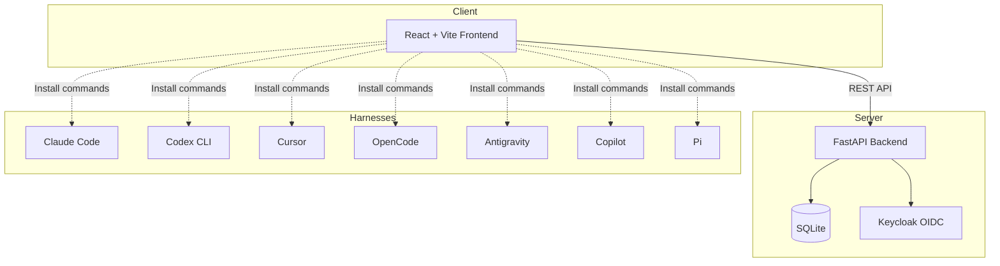

# Orbit Foundry

> Work in progress. This checkpoint may be incomplete or fail tests. See PLAN.md and STATUS.md before use.


**Multi-harness agentic plugin marketplace for Claude Code, Codex, Cursor, OpenCode, GitHub Copilot, Google Antigravity, and Pi** — Ryan Vo | AI & Machine Learning

Orbit Foundry is a unified catalog and installation hub for plugins, agents, skills, and commands that work across multiple AI coding tools (harnesses). It solves the fragmentation problem where each tool has its own marketplace, format, and discovery mechanism.

## Problem

AI coding tools have exploded in number — Claude Code, OpenAI Codex CLI, Cursor, OpenCode, GitHub Copilot, Google Antigravity, Pi — but each maintains its own plugin ecosystem. Developers waste time finding equivalent components, rewriting configurations, and managing multiple installation methods. There's no single source of truth for what's available, what works where, and how to install it.

## Approach

Orbit Foundry provides:

1. **Unified catalog** — One searchable database of 94+ plugins with 202 agents, 185 skills, and 105 commands
2. **Cross-harness compatibility matrix** — See which components work on which tools at a glance
3. **Installation guide generator** — Copy-paste commands tailored to your specific harness
4. **Skills-only installers** — Lightweight `gh skill` and `npx skills` support for individual components

The backend uses FastAPI with SQLite for persistence. The frontend is React + TypeScript + Vite. Authentication uses OIDC with Keycloak (SAML broker ready). All LLM integrations are opt-in, provider-agnostic, and server-side only.

## Quick Start

### Prerequisites

- Docker and Docker Compose
- Or: Python 3.12+, Node.js 24+

### With Docker (Recommended)

```bash
# Clone and start
docker compose up -d --build

# Services:
# - Frontend: http://localhost:5173
# - Backend API: http://localhost:8000
# - API Docs: http://localhost:8000/docs
# - Keycloak: http://localhost:8080 (admin/admin)
```

### Local Development

```bash
# Backend
cd backend
python -m venv .venv
source .venv/bin/activate
pip install -r requirements.txt
uvicorn app.main:app --reload --host 0.0.0.0 --port 8000

# Frontend (separate terminal)
cd frontend
npm install
npm run dev
```

## Architecture



## API Endpoints

| Method | Endpoint | Description |
|--------|----------|-------------|
| GET | `/api/v1/health` | Health check |
| GET | `/api/v1/plugins` | List plugins (paginated, filterable) |
| GET | `/api/v1/plugins/{id}` | Get plugin detail |
| GET | `/api/v1/plugins/by-name/{name}` | Get plugin by name |
| POST | `/api/v1/plugins` | Create plugin (admin) |
| PUT | `/api/v1/plugins/{id}` | Update plugin (admin) |
| DELETE | `/api/v1/plugins/{id}` | Delete plugin (admin) |
| GET | `/api/v1/harnesses` | List supported harnesses |
| GET | `/api/v1/harnesses/{id}` | Get harness detail |

## Features

### Plugin Catalog
- Search and filter 94+ plugins by category, name, description
- View plugin details: agents, skills, commands with descriptions
- Pagination for large catalogs
- External plugin support

### Harness Compatibility Matrix
- 7 supported harnesses with capability flags
- Installation method per harness
- Copy-to-clipboard commands

### Installation Guide
- Step-by-step instructions per harness
- Marketplace registration commands
- Plugin installation commands
- Skills-only installation (`gh skill`, `npx skills`)

### Authentication (Planned)
- OIDC authorization code flow with PKCE
- Keycloak realm with viewer/admin roles
- Demo mode for local development
- HttpOnly cookies with CSRF protection

## Configuration

Copy `.env.example` to `.env` and adjust:

```bash
cp .env.example .env
```

Key settings:

| Variable | Description | Default |
|----------|-------------|---------|
| `DATABASE_URL` | SQLite database path | `sqlite+aiosqlite:///./orbit_foundry.db` |
| `SECRET_KEY` | JWT signing key | **Change in production!** |
| `OIDC_ENABLED` | Enable Keycloak auth | `false` |
| `OIDC_ISSUER_URL` | Keycloak realm URL | `http://localhost:8080/realms/orbit-foundry` |
| `DEMO_MODE` | Allow unauthenticated local access | `true` |
| `LLM_API_KEY` | Optional LLM provider key | (empty) |

## Development

### Running Tests

```bash
# Backend tests
cd backend
source .venv/bin/activate
pytest -v

# Frontend tests
cd frontend
npm test
```

### Code Quality

```bash
# Backend
cd backend
source .venv/bin/activate
ruff check .
mypy app/

# Frontend
cd frontend
npm run lint
npm run build  # includes typecheck
```

## Deployment

### Production Checklist

- [ ] Set `ENVIRONMENT=production`
- [ ] Generate strong `SECRET_KEY`
- [ ] Set `DEBUG=false`
- [ ] Set `DEMO_MODE=false`
- [ ] Enable `OIDC_ENABLED=true` with real Keycloak
- [ ] Configure TLS reverse proxy (nginx/Traefik/Caddy)
- [ ] Set up automated backups for SQLite database
- [ ] Configure Keycloak with production realm and SAML IdP brokering if needed
- [ ] Set `CORS_ORIGINS` to your production domain

### Docker Production

```bash
docker compose -f docker-compose.yaml -f docker-compose.prod.yaml up -d
```

### Reverse Proxy (nginx example)

```nginx
server {
    listen 443 ssl http2;
    server_name orbit-foundry.example.com;

    ssl_certificate /etc/letsencrypt/live/orbit-foundry.example.com/fullchain.pem;
    ssl_certificate_key /etc/letsencrypt/live/orbit-foundry.example.com/privkey.pem;

    location / {
        proxy_pass http://frontend:80;
        proxy_set_header Host $host;
        proxy_set_header X-Real-IP $remote_addr;
        proxy_set_header X-Forwarded-For $proxy_add_x_forwarded_for;
        proxy_set_header X-Forwarded-Proto $scheme;
    }

    location /api/ {
        proxy_pass http://backend:8000;
        proxy_set_header Host $host;
        proxy_set_header X-Real-IP $remote_addr;
        proxy_set_header X-Forwarded-For $proxy_add_x_forwarded_for;
        proxy_set_header X-Forwarded-Proto $scheme;
    }
}
```

## Backup & Restore

```bash
# Backup
docker compose exec backend cp /app/data/orbit_foundry.db /app/data/backup-$(date +%F).db

# Restore
docker compose exec backend cp /app/data/backup-2024-01-15.db /app/data/orbit_foundry.db
```

## AI/ML Evaluation

This application serves as a **catalog and discovery layer** for AI coding tools. It does not itself perform ML inference. However, it enables evaluation workflows by:

1. Providing a unified index of agents/skills across harnesses
2. Allowing researchers to compare agent capabilities side-by-side
3. Supporting installation of evaluation-focused plugins (e.g., `plugin-eval`, `security-scanning`)

**Reproducible evaluation command:**
```bash
# Install plugin-eval skill via Orbit Foundry
gh skill install wshobson/agents plugin-eval

# Run evaluation on a skill
uv run --project plugins/plugin-eval plugin-eval score plugins/python-development/skills/python-testing-patterns --depth quick
```

**Data provenance:** Plugin metadata sourced from wshobson/agents (MIT licensed). Harness capabilities from official documentation.

**Limitations:** No automated benchmarking; evaluation requires manual skill installation and execution. Harness capability matrix based on documented features, not runtime verification.

## Security

- All API endpoints require authentication (when OIDC enabled)
- Role-based access: `viewer` (read) vs `admin` (write)
- PKCE for SPA authentication
- HttpOnly SameSite cookies for session management
- CSRF protection on state-changing operations
- Input validation via Pydantic schemas
- SQL injection prevention via SQLAlchemy ORM
- No secrets in repository (`.env` in `.gitignore`)

**Known limitations:**
- SQLite not suitable for high-concurrency production
- Demo mode bypasses auth — never enable in production
- Keycloak dev mode uses file-based DB — use PostgreSQL in production
- No rate limiting implemented (add via reverse proxy)

## License

MIT License — Copyright (c) 2024 Ryan Vo <ryandtvo@gmail.com>

See [LICENSE](LICENSE) for full text.